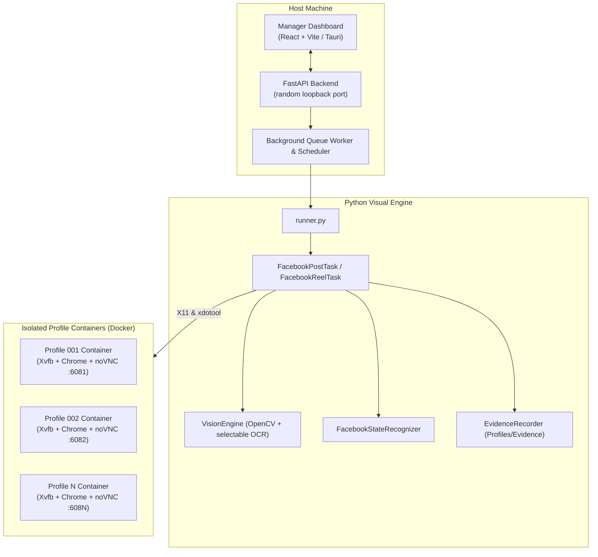

# Anti-Bot Browser: Zero-CDP Multi-Profile Automation Framework

[](https://www.docker.com/)
[](https://www.python.org/)
[](https://reactjs.org/)
[](https://vitejs.dev/)
[](https://opencv.org/)
[](https://github.com/JaidedAI/EasyOCR)
[](#)

A production-grade, anti-detection browser automation system engineered for scale. Built specifically to bypass modern anti-bot systems (such as Meta's Integrity heuristics) by eliminating Chrome DevTools Protocol (`CDP`) entirely in favor of **pure OS-level input dispatch, containerized profile isolation, and computer vision state verification**.

---

## 🚀 Key Architectural Pillars

### 1. Zero-CDP Input Dispatch
Traditional frameworks (Puppeteer, Playwright, Selenium) hook into the browser using Chrome DevTools Protocol (`Runtime.enable`, synthetic JavaScript DOM events, injected scripts). Modern anti-bot systems detect these hooks instantly.
* **Pure X11 Events:** Inputs are dispatched via `xdotool` and native X11 kernel/server events.
* **Interaction pacing:** Mouse movement uses curved paths with acceleration/deceleration. Caption entry chooses whole-caption typing or whole-caption paste with bounded session pacing; interaction style does not guarantee platform acceptance.
* **Native OS File Chooser Attachment:** Bypasses DOM `input[type="file"]` entirely. Interacts directly with Linux's GTK file chooser via keyboard navigation (`/` path shortcut).

### 2. Guarded Visual State Machine
Instead of relying on fragile, obfuscated CSS class names (`x1i10hfl xjbqb8w`) or blind `sleep()` timeouts:
* **Hybrid 3-Tier Localization:** Uses coordinate caching, OpenCV template matching, and signature HSV color masking (e.g. Facebook `#45BD62` green camera icon and `#0866FF` primary blue action buttons).
* **Selectable offline OCR:** PaddleOCR v5 + Tesseract by default, v6 + Tesseract for speed, or EasyOCR + Tesseract for legacy/generic use.
* **Pre/Post Structural Similarity (`SSIM`):** Compares screenshots before and after clicking publish to confirm modal closure and feed return.
* **Strict "Uncertain" Contract:** If a publish button was clicked once but confirmation is ambiguous, the task exits with code `2` (`uncertain`) and **never auto-retries blindly**, preventing accidental duplicate posts.

### 3. Containerized Profile Isolation
* Each profile runs in its own dedicated Docker container with an independent Xvfb display, x11vnc server, and noVNC web viewer.
* Viewer ports are published on host loopback only; they are not exposed to the LAN.
* **100% Proxy Tunneling:** All network traffic routes through dedicated residential SOCKS5 proxies per container.
* **Verified Browser Environment:** Profiles store requested settings separately from the effective container launch and observed runtime values. The UI does not claim that hardware or WebGL values are changed unless they are measured.

### 4. Evidence-Backed Execution Telemetry
* Photo/Reel executions write `telemetry.json` beside their screenshots under `profiles/<id>/automation_evidence/<run_id>/`.
* Measurements include total and stage duration, navigation/upload/readiness/verification timing, OCR latency and candidate counts, locator tiers and fallback reasons, semantic-provider latency, and available screen/locale/theme context.
* The queue dashboard calculates observed outcome rates plus median and p95 execution/OCR latency. It shows an empty baseline until measured executions exist; no performance target is presented as achieved without local runs.

---

## 📊 System Architecture



---

## Caption entry and optional hooks

Photo/text posts, Reels, and automated Live title/caption entry share one policy: captions below 100
whitespace-separated words randomly use full typing or full paste (50/50).
Captions of 100 words or more, captions containing links, link comments, Unicode,
and multiline text use full paste. Typing and pasting are never mixed. Clipboard
failures stop entry rather than falling back to typing. Entry checks existing
drafts, reads back content through the clipboard, and stops on focus/pointer
ownership loss or uncertainty. X11 cannot reliably detect all manual keyboard
intervention; avoid concurrent manual input while an attempt owns the profile. Live preset pinned comments are always pasted.
Live uses a separate adapter without screenshot evidence or field-content logs;
its existing Go live/End live gates and stream duration remain unchanged. Different
or unconfirmed drafts stop preparation for review. If a preset editor lacks a
recognized empty placeholder, preparation stops rather than assuming it is blank.

In the batch creator, enable **Generate opening hook** on a Photo or Reel row.
Supply a caption or description, optional audience/language/tone, and words to
avoid. Generation uses the Gemini key/model saved in Settings and sends only the
supplied text context and recent hook examples; it does not upload media. Choose
one of up to three options, edit it if needed, preview the full caption, and click
**Approve this caption** before scheduling. Source changes require another preview.
The original body and links are preserved, and approved captions bypass legacy
caption variations. Execution retries reuse the saved final caption without calling
an AI provider. Hook generation is off by default; legacy variations remain a
separate opt-in setting for captions without approved hooks.

Provider failures and missing context are explicit. Generated factual claims still
need operator review. Image/video analysis is a later enhancement. See
[the implementation plan](docs/HUMAN_MODE_PLAN.md) for module boundaries and limits.

## 🛠️ Supported Automation Workflows

**Studio Center → Reel Creator** turns one to five photos into a local news-style Reel.
Photos play for five seconds each and repeat until the video ends, including single-photo animation loops.
Choose gentle zoom, zoom in/out, fade, pan, or still. Turn subtitles off for a larger headline.
New reels default to 1080p/30 fps; Advanced holds timing, 720p/1080p resolution,
24/30/60 fps, music, branding, and layout. Previous motion presets and layouts remain available.
Preserve full images or crop to fill,
add optional Khmer/English text, branding and music, preview, then export MP4 or
append it to the existing Reel posting draft. Paste an article link or full text
to prepare scene text and a post caption with your saved Gemini model. Choose the template and settings first, then review and apply the suggestions. Local text-fit checks flag settings changes; adaptation and scene shortening run only when requested.
Optional English narration has its own editable article-based script and voice
preview. Online `edge-tts` prepares speech once; local exports reuse that recording
and automatically lower background music while it speaks.
Three original news soundtracks are included offline. Rendering does not publish. See
[Reel Creator setup and limits](docs/REEL_CREATOR.md).

The **Studio Center → Facebook Live** tab broadcasts uploaded videos without a camera. Save streaming
settings in Edit profile, select videos and profiles, use Automatic playback or choose Manual loop/duration
settings, enter each video’s title, caption and optional preset pinned comment, and start now or schedule. Track progress and stop streams in Live queue.
This local feature uses a template-driven Live Producer task and a separate FFmpeg
streaming service. Choose the broadcast destination in Facebook; the app fills and saves the supplied
title and caption before streaming. See [Live setup and limits](docs/live-video.md) for pilot results and limits.

| Task | Description | Verification Method |
| :--- | :--- | :--- |
| **Feed Image / Photo Post** | Automates single/multi-image feed posts with custom caption and emojis. Supports 2-step Facebook modals (`Next` ➔ `Post review` ➔ `Publish`). | Visual state machine (`POST_ENABLED` ➔ `FEED_READY` via SSIM). |
| **9:16 Vertical Reel** | Desktop Reel Studio creation (`/reel/create/`), video dropzone attachment, and video transcode readiness polling. | Polling enabled blue `Next`/`Publish` actions + toast detection. |
| **Organic 1st Comment Link** | Navigates to user profile (`/me`), identifies top post card, and submits destination link as comment. | OCR `"Comment as"` field detection + single-submission lock. |
| **Feed Warming** | Simulates natural human browsing, feed reading, and randomized scrolling. | Randomized Bézier cursor movement and scroll deltas. |

All Reel templates hand off their final Post click to the shared
`automation/modules/reel_post_click_verifier.py` module. It handles optional
“Not now” dismissal with its own 60-second budget, starts a fresh 90-second
composer/upload wait after dismissal, and waits up to 30 seconds for a success
popup after confirmed composer closure. Without the prompt, the upload wait
starts after Post. Unconfirmed closure stops as uncertain without refreshing;
every profile verification navigation rechecks closure. The module never
clicks Post again.

---

## 📁 Repository Structure

```
├── automation/                 # Python Zero-CDP Visual Automation Engine
│   ├── engine/
│   │   ├── container_client.py # Docker X11 / xdotool / scrot bridge
│   │   ├── evidence.py         # Screenshot & diagnostic JSON recorder
│   │   ├── human_input.py      # Bézier curves, natural typing, xclip
│   │   ├── screen_state.py     # Facebook visual state machine & OCR signals
│   │   ├── telemetry.py        # Bounded timing, OCR, locator & environment metrics
│   │   └── vision.py           # Multi-tier CV (Cache, Template, HSV, OCR)
│   ├── models/easyocr/         # Legacy/generic OCR weights (CRAFT + CRNN)
│   ├── models/paddleocr/       # Pinned v5 and v6 detection/recognition weights
│   ├── tasks/                  # Task definitions (Post, Reel, Warming, Comment)
│   ├── templates/              # OpenCV visual templates (icons, buttons)
│   ├── tests/                  # Offline reliability and safety test suite
│   ├── requirements.txt        # Python dependencies
│   └── runner.py               # CLI task dispatcher
├── container/                  # Docker container definitions
│   ├── Dockerfile              # Ubuntu 22.04 + Chrome + Xvfb + TigerVNC + tun2socks
│   ├── entrypoint.sh           # Container init script
│   └── fonts.conf              # Font rendering optimizations
├── manager-app/                # Management Dashboard
│   ├── src/                    # React frontend (VNC viewer, queue, profiles)
│   ├── src-tauri/              # Optional desktop shell
│   └── package.json            # Frontend scripts and dependencies
├── backend/                    # FastAPI API, scheduler, and profile lifecycle
│   ├── routers/                # Validated REST endpoints
│   ├── services/               # Containers, proxies, queues, and profiles
│   └── main.py                 # FastAPI application entry point
├── profiles/                   # Profile definitions & evidence storage
│   ├── config.example.json     # Sample profile configuration
│   └── <profile_id>/           # Profile-specific data (ignored by git)
├── proxies/                    # Proxy pool configuration
│   └── proxy_pool.example.json # Sample proxy pool definition
└── scripts/                    # Helper shell scripts (build, run)
```

---

## ⚡ Getting Started

Whole-app releases and Settings > App updates are described in
[App releases and updates](docs/APP_RELEASES.md). Ordinary pushes are development;
version tags build drafts, and a human publishes a tested release. VERSION is
the release source of truth (`node scripts/release-version.mjs set VERSION`).

### 1. Prerequisites
* **Docker Engine** with Docker Compose
* **Node.js** (v18+) & `npm`
* **Python** (3.10+ / 3.12 recommended)
* Host OS: Linux or Windows (WSL2)

On Windows, `install-windows.ps1` detects physical RAM and recommends a WSL2
memory ceiling. The default choice is 50% for hosts below 24 GB and 75% for
hosts with 24 GB or more (for example, 24 GB on a 32 GB machine). Existing
`.wslconfig` memory settings are preserved. Use `-KeepWslDefaults` to retain
Microsoft's default policy or `-WslMemoryGB <GB>` for an explicit unattended
choice. Applying a new limit restarts WSL during setup.

Open **Settings → Setup and repair → Install / update runtime** after installing a newer desktop release.
This runs the complete installer from that release, rather than only starting services.
It updates bundled backend/automation code and dependencies, preserves profiles and
Brain activation choices, and starts the updated desktop-managed backend. Running
jobs must finish first. An independently managed worker service must be stopped
by its service manager, then reopen the app before repairing its runtime; this button does not replace
or stop that background service automatically.

Setup uses Python 3.12 for the pinned OCR dependencies. If a compatible local
interpreter is unavailable, it downloads a private copy under the application
runtime. It preserves an incompatible virtual environment as a backup before
replacing it, without changing the system Python or browser profile data.

The desktop Install/Repair action also installs the Mesa diagnostics and
drivers used by browser acceleration. Profile startup supports native Linux
`/dev/dri` devices and the WSL2 `/dev/dxg` bridge. `host_gpu` is the default;
if the requested device or libraries are unavailable, the container starts
with software rendering and records the fallback reason instead of claiming
hardware acceleration. Native Linux uses ANGLE's Vulkan backend so Chrome can
render through the DRM device even though the private Xvfb display has a
software-only GLX renderer.

Each Chrome start first visits a loopback-only diagnostic page. It records the
browser-visible user agent, Client Hints, language, timezone, screen values,
CPU and memory values, automation flag, and WebGL renderer without CDP or
external requests, then continues to the requested start URL. The Profile
Inspector shows these observed values and uses Chrome's WebGL result—not the
container's GLX result—to determine the effective rendering mode.

The manager starts one loopback-only OCR worker and keeps the selected
OCR model warm for all automation processes. Requests are serialized
through that worker so concurrent profiles share one CUDA model allocation
instead of loading a separate copy per process. Each automation process keeps
its existing local OCR fallback if the shared worker is unavailable.

The desktop manager also starts its API on a fresh random `127.0.0.1` port
for every app launch. A fresh session token is delivered to the embedded
frontend through Tauri IPC and is required by every API and shared-media
request. The service is therefore unreachable from the LAN and unusable by
ordinary local HTTP clients that do not belong to the running app session.

### 2. Container Image Build
Build the isolated Chrome container base image:
```bash
bash scripts/build_container.sh
```
*(Creates the `isolated-chrome:latest` local image)*

### 3. Setup Python Automation Engine
Create a virtual environment and install dependencies:
```bash
cd automation
python3 -m venv venv
source venv/bin/activate
pip install -r requirements.txt
python bootstrap_paddle_runtime.py
# Restore the common OpenCV module after EasyOCR installs its headless dependency.
pip install --force-reinstall --no-deps opencv-contrib-python==4.10.0.84
python bootstrap_ocr_models.py --engine all
```
Paddle GPU setup uses a separate environment under `data/python-runtime` so its
CUDA 12 cuDNN libraries do not overwrite PyTorch/EasyOCR's CUDA 13 libraries.
The backend probes and starts the shared Paddle OCR worker with that interpreter;
automation processes retain their normal environment and local CPU fallback.
Setup downloads pinned Paddle models and EasyOCR weights once; normal inference
uses local assets. `install.sh` performs these steps automatically.

Run the offline visual verification test suite:
```bash
python3 -m unittest discover -s tests
```

### 4. Setup Manager Application
```bash
cd manager-app
npm install
npm run build
```

For **browser development without rebuilding the desktop app**, close the
installed desktop first, then run this from the source checkout (Linux/WSL):

```bash
cd manager-app
npm run dev:web
```

Open **http://127.0.0.1:5173**. React/CSS changes reload automatically. Stop with
Ctrl+C and rerun the command after Python changes; no desktop build or install
is needed. `npm start` runs the same development launcher.

This uses the existing desktop profiles, queues, media and settings under
`~/.local/share/com.isolatedbrowser.manager/runtime`. Set `AUTOMAT_FB_ROOT` to use
a different initialized data root. The launcher respects the same backend lock
as the desktop and refuses to start a second scheduler against that data.

Both servers listen on loopback only. Vite proxies the API and media to a
random-port authenticated source backend; its session token stays in the
server process and is not included in browser JavaScript. This is a local
development workflow. Browser mode uses normal file pickers/downloads; native
setup, update and desktop integration actions require the desktop app.

To open the native desktop app during development:
```bash
cd manager-app
npm run tauri:dev
```
Tauri starts Vite at `http://127.0.0.1:1420` and owns one authenticated Python
backend on an available loopback port. Native development uses the source
checkout and its `automation/venv`, while profiles, queues, and settings use the
same persistent runtime as the installed desktop app. It does not require
rebuilding the frozen backend executable. If an independent worker service is running, the desktop
attaches to it instead.

---

## ⚙️ Configuration

### Profile lifecycle

Create profiles through the dashboard or `POST /api/profiles`. The backend owns
profile IDs, display ports, proxy reservations, and atomic configuration writes.
Network intent is explicit, so a direct profile can never silently acquire a
pool proxy:

```json
{
  "name": "Primary Account",
  "network": {
    "mode": "direct"
  },
  "requested_environment": {
    "screen_resolution": "1920x1080",
    "timezone_policy": "host",
    "timezone": "America/Guatemala",
    "language": "en-US",
    "user_agent_policy": "browser_default",
    "user_agent": null,
    "rendering_mode": "host_gpu"
  },
  "resources": {
    "cpu_limit": 4,
    "memory_mb": 4096
  }
}
```

Resource limits default to 4 vCPU and 4 GiB per profile. They are ceilings, not
reservations, and can be changed when creating or editing a profile. At startup
the manager records the Docker-applied limits alongside an
`effective_environment` snapshot and bounded
container observations. Runtime-sensitive edits set `restart_required` until
the profile is stopped and started again. Legacy profiles are migrated to
the current schema with a versioned `config.json.v*.bak` backup; browser data is untouched.

### Configuring Proxies
Copy `proxies/proxy_pool.example.json` to `proxies/proxy_pool.json` to manage rotating SOCKS5 residential proxies.

### Guarded Semantic Fallback

Semantic candidate ranking is in shadow mode by default. It receives only local
OCR labels and candidate IDs, then records its proposal without clicking. A
proposal must be found again on a fresh screenshot, remain in the expected
region, match the expected screen state, and have an enabled visual action.
Final Post/Publish actions always remain behind the manual review gate.

Runtime controls:

```bash
SEMANTIC_FALLBACK_PROVIDER=heuristic       # heuristic, gemini, or openai
SEMANTIC_FALLBACK_SHADOW_MODE=true         # keep true during evaluation
SEMANTIC_FALLBACK_MIN_CONFIDENCE=0.80
SEMANTIC_FALLBACK_MODEL=<provider-model>   # only for an external provider
```

The queue dashboard reports shadow proposals, deterministic validation rate,
fresh-label confirmations, blocked clicks, and provider latency. These are
evaluation metrics, not permission to enable automatic publishing.

Replay saved evidence without opening or controlling a browser:

```bash
python3 automation/evaluate_semantic_shadow.py --max-per-scenario 3
```

The latest balanced report is written to
`automation/reports/semantic_shadow_latest.json`. Offline replay measures
ranking against recorded targets; temporal freshness still requires passive or
normal-run shadow observations.

### Bounded Scheduler

Scheduled automation uses persisted, heartbeat-backed leases. Defaults permit
one publisher, one optional passive preparer, and two total automation workers.
Only one task may hold a lease for a profile. Lease IDs are fencing tokens, so a
stale process cannot overwrite the outcome of a newer claim. Expired work is
recovered using the persisted execution stage: pre-publish interruptions fail
before publish, while post-click interruptions become `uncertain`.

Resource Mode is configured from the Posting Queue dashboard and persisted in
`data/manager_settings.json`. Auto selects the lowest tier supported by both RAM
and CPU: Low uses 1 publisher + 1 preparer (2 containers), Medium uses 2 + 2
(4 containers), and High uses 3 + 3 (6 containers). New container starts pause
at 80% RAM until usage falls below 70%, pause at 85% sustained CPU, and are
spaced by at least 10 seconds. Mode changes affect only new claims and never
interrupt active tasks.

Accounts publishing the same batch post may run concurrently within the selected
mode's publisher limit (Low: 1, Medium: 2, High: 3). Each account holds at most
one automation lease and advances through its iterations independently. After
its current task finishes, its container closes and its iteration delay must
finish before preparation or publishing starts for its next post. Other accounts
can continue while it waits; uncertain outcomes hold that account's later posts
for review. Container admission continues
to enforce memory, CPU, container-count, and start-spacing limits.

Lease timing remains configurable when needed:

```bash
AUTOMATION_LEASE_TTL_MS=60000
AUTOMATION_HEARTBEAT_INTERVAL_MS=15000
```

Feed Warming settings are available in Campaign → Instant Multi-Runner and in
single-profile automation. Choose fixed depth or a random cycle range (1–30),
reading pace, and news feed, own profile, or a random surface. Optional rereading,
longer pauses, cursor movement, and a final upward scroll vary passive browsing.
New sessions default to 3–8 cycles with a 180-second browsing limit; existing
queued sessions keep their fixed depth. The limit excludes authentication and
page loading, and an input action already in progress can finish after it.
Sessions report actual scroll actions and browsing duration. Warming does not
like, comment, or send messages.

Batch session preparation uses a rolling resource-mode pipeline. Brief mode
browses for 40–55 seconds and Extended mode for 55–70 seconds. Preparation
starts the next profile only when capacity is available, verifies authentication
and theme, scrolls without likes/reactions/comments, scrolls back up, and
keeps that profile ready while the current profile publishes. Profile order is
shuffled once per batch and persisted across restarts. Passive preparation uses
1–4 wheel-notch bursts, bounded reading pauses, and occasional small mouse
repositioning within the content area. The pointer normally rests, but moves off
Chrome's toolbar before scrolling. Short upward rereads occur only after downward
movement. Repeated unchanged views get one bounded direction check before browsing
ends early. The return scroll uses short bursts with an eight-second handoff budget;
it does not claim that the page reached the top. Logs report remaining time and
results distinguish requested scrolls from observed visual changes. After every terminal
publish outcome, the report is saved before the profile container is stopped.
The queue exposes the persisted flow
`pending → preparing → ready → running → verifying → published`, with at most
one publisher, one preparer, and two active profile containers by default.

---

## 🔒 Security & Anti-Leak Safeguards

The project is pre-configured with a strict [`.gitignore`](.gitignore) to ensure sensitive operational data is never committed to source control:
* **Browser Cookies & Storage:** Excludes all `profiles/*/chrome_data/` directories.
* **Credentials:** Excludes active `proxy_pool.json` and profile `config.json` files.
* **Evidence:** Diagnostic screenshots and JSON metadata under `automation_evidence/` remain local.

---

## 📜 License

This project is licensed under the MIT License.

## Cloud worker service

The optional Python worker agent runs with the existing backend independently of
the desktop window. It uses secure WebSocket (`wss://`) for cloud coordination
and HTTPS for media/evidence transfers. See [worker setup and scope](docs/worker/README.md)
and [protocol v1](docs/worker/protocol-v1.md). The cloud gateway offers the matching `/ws/workers` adapter;
local protocol and recovery behavior are verified with simulated-server tests.

### Reel profile timestamp confirmation

Before the Reel comment step, only the first post header under the profile's
Posts/List view toolbar is checked. The parser accepts now/seconds or a numeric
age strictly below ten minutes; 10m, hours and days are rejected. Small known OCR
word substitutions and scored unit matches are supported, while ambiguous numeric
text or unknown units remain unconfirmed. The first post's timestamp is read on
the first card's header, with or without an author, including separate Published
by attribution. Standalone ages such as `1m`, `30s`, and `30 seconds ago` are
supported; timestamp-only rows must remain near the top of that header.
Unreadable headers get one enlarged OCR read of the same region. Recognized old
timestamps report `old_top_post`; a separated trailing privacy-icon OCR suffix
such as `2h . 0` is ignored without guessing numeric ages.
Caption text, comment timestamps and second posts cannot supply confirmation.
If the top post is old/unreadable, the same top position can be rechecked after
one refresh delay; the task never searches later posts for a newer timestamp.
A Facebook success popup may still establish publication, but commenting still
requires this top-post check. Timestamp checks alone do not prove media identity.

`about a minute ago` is parsed as a one-minute age, including attributed
header rows. Conflicting timestamps still fail the recency check.

### OCR engine selection and recovery

Use the **OCR engine** dropdown beside the global resource controls:

- **v5 + Tesseract (Default):** PaddleOCR v5 for accuracy.
- **v6 + Tesseract (Speed):** PaddleOCR v6 for lower latency.
- **EasyOCR + Tesseract (Legacy / Generic):** the existing EasyOCR reader.

The choice is saved in `data/manager_settings.json`. Restart the app or backend
service to apply it; active jobs keep their startup engine. The shared worker and
local fallback use that same engine, with separate caches for each model.
`AUTOMATION_OCR_ENGINE=paddleocr-v5`, `paddleocr-v6`, or `easyocr` overrides the
saved choice and locks the dropdown while that launch configuration is active.
Paddle runs on CPU with the pinned package supplied by setup; GPU availability
is checked against the selected framework.

Bounded expected-label searches (buttons and
input labels) may retry a miss with Tesseract. Timestamp checks may retry an
unreadable short header candidate after the existing enlarged primary OCR read.
Secondary text must agree at 3x and 4x with confidence at least 0.60; successful
primary reads, recognized old timestamps, and conflicting ages skip recovery.
All action/geometry checks still apply. Full-screen secondary OCR is disabled.

Linux and Windows/WSL setup installs `tesseract-ocr` and `tesseract-ocr-eng` on
the host where Python automation runs. Existing installs can add these packages
separately. Missing Tesseract fails closed to the existing OCR outcome. Set
`AUTOMATION_TESSERACT_ENABLED=0` to disable, `AUTOMATION_TESSERACT_BIN` to select
an executable, or `TESSDATA_PREFIX` to select its model directory. Secondary OCR
uses stdin, a subprocess timeout, a bounded cache, and records engine provenance
plus OCR telemetry. No browser evidence is sent to an external OCR service.

For offline EasyOCR/PaddleOCR evaluation against saved profile screenshots, see
[the comparison guide](docs/OCR_ENGINE_COMPARISON.md) and
[measured results](docs/OCR_ENGINE_COMPARISON_RESULTS.md). The evaluation uses
separate environments and local evidence snapshots without browser actions.
These crop measurements informed the default; they are not full publication tests.
